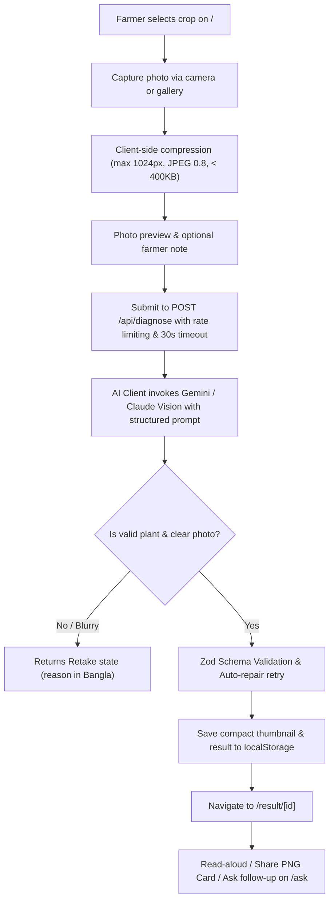

# How It Works: মাঠের ডাক্তার (Mather Daktar)

## 1. Overview and Core User Journey

"মাঠের ডাক্তার" (Mather Daktar) is designed to run seamlessly on low-cost Android mobile devices over 3G/4G cellular networks in rural Bangladesh. The application operates entirely without requiring an account, email, or password, prioritizing immediate utility, accessibility in colloquial Bangla, and strict farmer safety.

### End-to-End Flow Diagram



---

## 2. Client-Side Image Processing & Compression

Farmers often capture high-resolution photos (8-48 megapixels, 5-15 MB) that fail or timeout over unstable rural mobile networks.

1. **Local Pre-Validation (`lib/image/validate.ts`)**:
   - Rejects non-image files and files larger than 15 MB before consuming memory.
2. **Client Canvas Resizing (`lib/image/compress.ts`)**:
   - Rescales the longest side to a maximum of 1024 pixels, preserving the aspect ratio.
   - Encodes as JPEG with an initial quality of 0.8.
   - If the resulting base64 payload exceeds 400 KB, it dynamically steps down the quality to 0.65.
3. **Thumbnail Creation**:
   - Generates a lightweight 320px thumbnail for offline `localStorage` caching, ensuring that saved history fits within standard mobile browser storage quotas (5-10 MB).

---

## 3. Server Architecture & API Protection

All AI interactions run strictly server-side through Next.js Route Handlers (`app/api/`):

- **Zero Client Leakage**: The `AI_API_KEY` never reaches the browser bundle or client runtime.
- **Sliding-Window Rate Limiter (`lib/rate-limit.ts`)**:
   - Restricts each client IP to 20 diagnosis requests per 10 minutes.
   - Returns HTTP 429 with a clear, polite Bangla explanation rather than cryptic technical codes.
- **Strict Input Validation**:
   - Zod schemas (`DiagnoseRequestSchema`, `ChatRequestSchema`, `SeasonRequestSchema`) sanitize all incoming parameters.
   - Image payloads are capped at 2 MB in base64 length.
- **Strict Privacy**:
   - Uploaded photos are processed in memory and **never saved to disk or persistent cloud databases**.

---

## 4. AI Prompt Strategy & Structured Output

The system prompt (`lib/ai/prompts.ts`) is calibrated with strict instructions tailored for Bangladeshi agriculture:

1. **Simple Spoken Bangla (সাধারণ কথ্য বাংলা)**:
   - Forbids English jargon and unexplained Latin scientific names.
2. **Bangladeshi Agricultural Context**:
   - Focuses on practices and inputs available to smallholders in Bangladesh (e.g., Integrated Pest Management, light traps, neem extract, Trichoderma, wood ash, proper field drainage).
3. **Pesticide Safety Prohibition**:
   - **Never invents or prescribes exact chemical dosages, millilitres, or commercial brand names.**
   - Names treatment categories only (e.g., "অনুমোদিত ছত্রাকনাশক" or "মাকড়নাশক") and always instructs farmers to consult the packaging label and the Upazila Agriculture Officer.
4. **Honesty Over Hallucination**:
   - If the image is blurry, too dark, or not a plant, the AI outputs `isPlant: false` or `imageQuality: "poor"` along with a friendly `retakeReason` in Bangla instead of fabricating a disease.

---

## 5. Structured Output Parsing & Self-Repair

1. **Structured Mode**:
   - For Gemini, requests utilize `application/json` output mode.
   - For Claude, JSON formatting is enforced through system prompt specifications.
2. **Resilient Extraction (`lib/ai/parse.ts`)**:
   - Automatically strips any accidental markdown code wrappers (````json ... ````) or conversation text.
3. **Zod Validation & Auto-Repair**:
   - The response is parsed against `DiagnosisSchema`.
   - If the model's output fails schema validation, the server automatically executes a single fast retry with the validation errors fed back to the model, ensuring high reliability.

---

## 6. Known Boundaries & Limitations

- **Image Quality**: Accurate diagnosis depends on clear lighting and close-up focus on the affected leaf or stem. The app explicitly catches blurry images and instructs the user to retake them.
- **Severe Outbreaks**: When high severity or low diagnostic certainty is detected, the app automatically surfaces the verified Krishi Call Center hotline (`16123`) to connect the farmer directly with government extension specialists.
